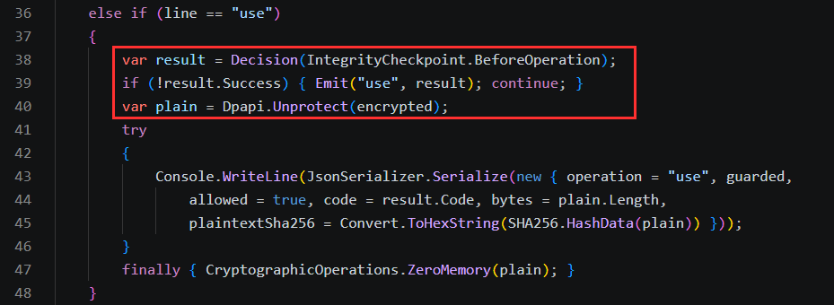
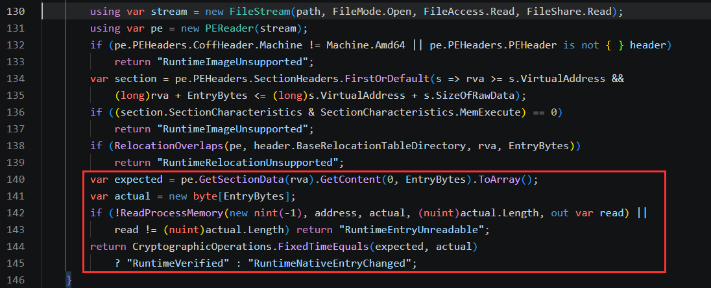

<div align="center">

# Thick App Integrity Guard

**Detect selected runtime hooks. Gate sensitive operations. Verify signed files.**


[Quick start](#quick-start) · [Integration](#integrate-the-runtime-check) · [How it works](#how-the-runtime-check-works) · [Documentation](#documentation) · [Releases](https://github.com/ErenCanOzmn/Thick-App-Integrity-Guard/releases)

</div>

A small Windows integrity library for thick-client applications. It checks selected native function entries for changes and lets the application stop a sensitive operation before calling them. A separate signed-manifest API verifies files and returns the exact bytes that passed verification.

**This is a reference implementation, built to be understood and improved.** Adapt its coverage, error handling, deployment, and performance to your application. More comprehensive implementations can be built; this example is not a ready-to-deploy security product.

## What problem does it address?

A runtime analysis tool can observe plaintext when an application decrypts a secret, even if the application clears its buffer afterward. An unchanged DLL on disk does not establish that its loaded code is unchanged in memory.

This project adds a local decision point **before** the sensitive call:

```text
Operation requested
    -> Check debugger state and selected native entry bytes
    -> If verification fails: block the operation and latch the session
    -> If verification succeeds: let the application continue
```

The result is bounded defense in depth. It does not stop tool attachment, hide every memory read, or make the process trustworthy to a server.

| Capability | .NET API | Native C ABI |
| --- | --- | --- |
| Runtime entry and debugger checks | `RuntimeIntegritySession.Check(...)` | `ig_runtime_check(...)` |
| Signed file snapshots | `IntegritySession.Check(...)` | `ig_open`, `ig_check`, `ig_copy_file`, `ig_close` |

The APIs are independent. A file verification call does not automatically perform a runtime check.

## Quick start

**Requirements:** Windows x64 and the .NET 8 SDK or a compatible newer SDK. The runtime demo does not require Python, Visual Studio C++, or a signing key.

```powershell
git clone https://github.com/ErenCanOzmn/Thick-App-Integrity-Guard.git
cd Thick-App-Integrity-Guard

# Run the runtime regression tests and build the DPAPI demo.
.\build-runtime.ps1
.\artifacts\runtime-probe\RuntimeProbe.exe
```

At the prompt:

```text
check
use
exit
```

`use` runs the runtime check immediately before decrypting **synthetic** DPAPI data. Output contains the decision, byte count, and a comparison hash; it does not print the plaintext. No database, real credential, or external service is used.

To run the same laboratory without the gate:

```powershell
.\artifacts\runtime-probe\RuntimeProbe.exe --unguarded
```

`--unguarded` is a comparison mode for the demo, not a production recovery option.

## Integrate the runtime check

Reference [IntegrityGuard.csproj](src/IntegrityGuard/IntegrityGuard.csproj), or build the local NuGet package with `build-package.ps1`. Keep **one session** for the application workflow:

```csharp
using IntegrityGuard;

var runtime = new RuntimeIntegritySession();

// Before preparing sensitive data or enabling the protected feature:
var startup = runtime.Check(IntegrityCheckpoint.Startup);
if (!startup.Success)
    return;

// Later, immediately before the sensitive operation, use the SAME session:
var decision = runtime.Check(IntegrityCheckpoint.BeforeOperation);
if (!decision.Success)
    return;

// The application may now perform its sensitive operation.
```

The first failed check blocks that session. Removing a hook does not reopen it. The host owns scheduling, error presentation, and the protected operation; the library does not terminate processes or start a hidden timer.

The actual call site in the demo:



For C/C++, build the native library and use [integrity_guard.h](native/include/integrity_guard.h):

```c
if (ig_runtime_check(IG_BEFORE_OPERATION) != IG_OK) {
    return; /* Do not start the sensitive operation. */
}
```

The native runtime gate is retained for the process lifetime. Closing or reopening a signed-file session cannot reset it. See the [native contract](docs/NATIVE.md) for loading, return codes, and lifetime rules.

## How the runtime check works

The default policy compares the first **32 bytes** of four native entries with their backing Windows PE files:

| DLL | Entry point | Boundary being observed |
| --- | --- | --- |
| `crypt32.dll` | `CryptProtectData` | Plaintext before protection |
| `crypt32.dll` | `CryptUnprotectData` | Plaintext after unprotection |
| `bcrypt.dll` | `BCryptFinishHash` | Hash finalization |
| `ncrypt.dll` | `NCryptVerifySignature` | Signature verification |

The reference is read from the backing System32 file, not copied from potentially modified process memory. Forwarded exports are resolved to the module that actually owns the address. Unreadable entries, unsupported images, and relocation overlaps fail the check rather than being silently accepted.



Debugger state is checked separately through .NET and Windows debugger APIs. A negative debugger result does not establish that instrumentation is absent. Policies can select other system DLL/export pairs; the platform and comparison limits still apply.

Read the [runtime design and threat model](docs/RUNTIME.md) before extending the policy.

## Signed file verification

The second API authenticates a bounded set of file snapshots:

1. The signer writes file SHA-256 digests and a release number to a manifest.
2. ECDSA P-256 signs the exact manifest bytes; the application pins the public key.
3. Verification checks the signature, exact inventory, release floor, and digests.
4. Successful verification returns verified byte copies. Consume these instead of reopening the source files.

Limits: **1–32 flat filenames**, **32 MiB per file**, **64 MiB total**, and a **64 KiB manifest**. The host must supply a trusted minimum release; a rollbackable local setting is not rollback protection.

The [signed-file integration guide](docs/INTEGRATION.md) describes the contract. [ProtectedRules.cs](samples/CustomerIntegration/ProtectedRules.cs) demonstrates business-schema validation after signature verification.

## Build outputs

| Command | Output / purpose | Additional requirements |
| --- | --- | --- |
| `./build-runtime.ps1` | DPAPI comparison demo and runtime tests | Windows x64, .NET SDK |
| `./build-package.ps1` | `artifacts/packages/IntegrityGuard.0.4.0.nupkg` | Windows x64, .NET SDK |
| `./build-native.ps1` | Native DLL, import library, and native consumer tests | MSVC C++ tools, Windows SDK, CMake, Python 3 |
| `./build-example-apps.ps1` | Signed-file WinForms/console demos and process tests | Windows Desktop targeting pack, Python 3, desktop session |
| `./build-release.ps1` | Versioned ZIP and SHA-256 checksums | Native build requirements above |

The managed `IntegrityGuard.dll` and the NativeAOT `IntegrityGuard.Native.dll` are different artifacts. The native library does not require a .NET installation in the consuming process. NativeAOT library unloading is unsupported.

C and Python file consumers have been exercised against the real native DLL. Lua 5.4 and LuaJIT bindings are included as source; **their runtime validation is not complete**. Linux, macOS, ARM64, and .NET Framework are outside the verified scope.

## Validation

Recorded local Windows x64 validation for 0.4.0:

| Suite | Result | What it exercises |
| --- | --- | --- |
| Signed-file regressions | 27 passed | Signatures, digests, schema, snapshots, rollback floor, session state |
| Runtime core | 7 passed | Clean entries, controlled byte modification, policy and session behavior |
| ABI | 13 managed + 13 native passed | Actual exports, buffers, handles, runtime gate |
| Runtime instrumentation | 6 managed + 6 native-host scenarios passed | Exact synthetic-data capture, operation rejection, detach behavior, passive attachment, selected entry hooks |
| Manifest signer | 11 scenarios passed | Invalid input preserves an existing signed pair |
| Application processes / GUI | 7 scenarios + 6 controls passed | Real signed-file demo behavior |
| Native file consumers | 5 passed | C executable and Python binding |

Instrumentation comparisons used Frida **16.6.4** and an unchanged analysis script against this repository's synthetic lab. They cover **post-startup attachment**, not every injection, bypass, or tool version. Passive attachment alone was accepted; selected entry hooks were detected.

The external script is not bundled. Supply its local path to reproduce the comparison:

```powershell
.\build-runtime.ps1 -SafiyeScript C:/tools/analysis/hooks/safiye_frida_script.js `
    -NativeDll C:/project/artifacts/native/win-x64/IntegrityGuard.Native.dll
```

These are local development results, not independent certification. Details are in [RUNTIME.md](docs/RUNTIME.md) and [EXAMPLE-APPS.md](docs/EXAMPLE-APPS.md).

## Security boundaries

- Only configured native entry windows are compared. Managed methods, IAT hooks, mid-function changes, unmonitored providers, and kernel/hypervisor observation are not comprehensively measured.
- The check and subsequent sensitive call are not atomic. A check/call race remains.
- EDR, antivirus, hotpatching, or a Windows update can cause legitimate differences. Validate compatibility and recovery in the target environment.
- Backing OS files, address resolution, memory reads, and the gate itself remain in the local trust domain. An attacker controlling the process can target them.
- Keep authorization and high-value decisions on the server. `RuntimeVerified` and `Verified` are local decisions, not attestation tokens.
- Keep signing private keys out of installations and source control. Test the final obfuscated/signed build rather than extrapolating from a development build.

## Documentation

| Guide | Start here when you need… |
| --- | --- |
| [Runtime protection](docs/RUNTIME.md) | Entry-byte checks, debugger policy, false positives, instrumentation comparisons |
| [.NET signed files](docs/INTEGRATION.md) | Pinned keys, verified snapshots, session and observer contracts |
| [Native ABI](docs/NATIVE.md) | C/C++, Python/Lua bindings, return codes, buffer ownership |
| [Deployment](docs/DEPLOYMENT.md) | Signing order, updates, obfuscation, release acceptance |
| [Example applications](docs/EXAMPLE-APPS.md) | Runtime and signed-file demos, real process/GUI coverage |
| [Changelog](CHANGELOG.md) | Version history |

## License

This repository does not currently include a LICENSE file. Contact the project owner for usage and redistribution terms.

Built by [Eren Can Özmen](https://github.com/ErenCanOzmn).
